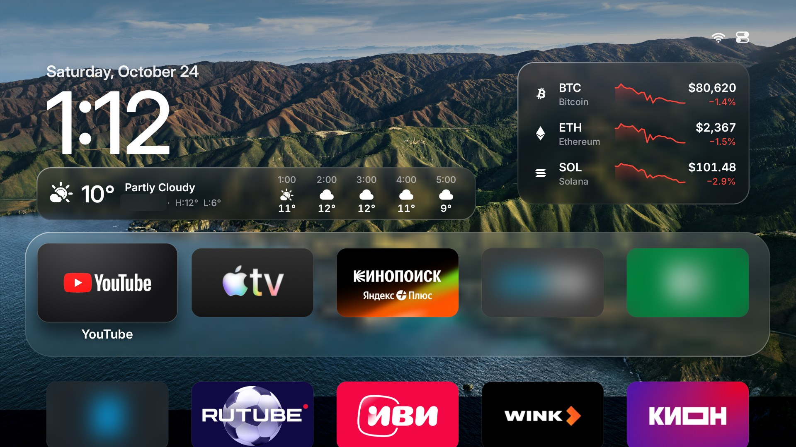
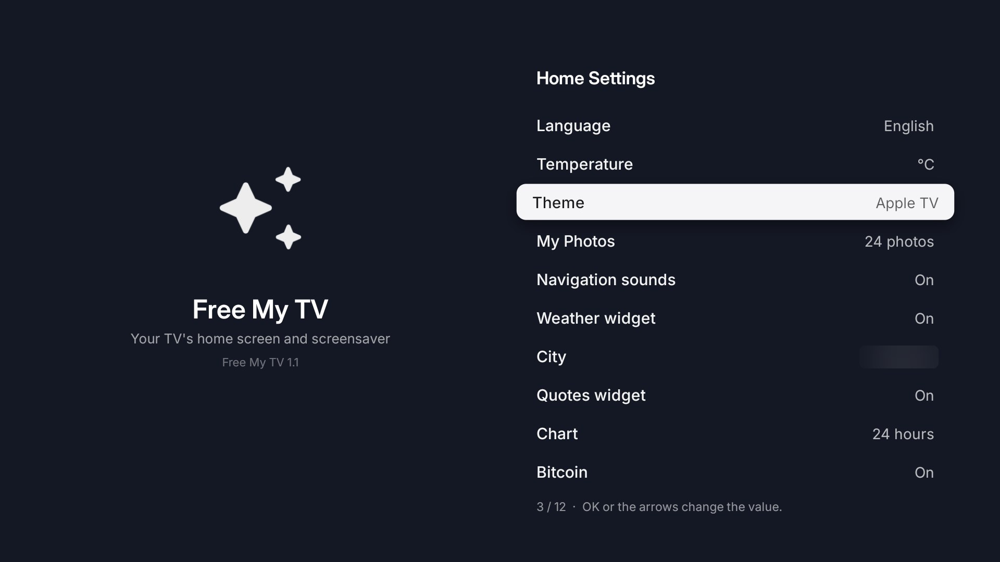
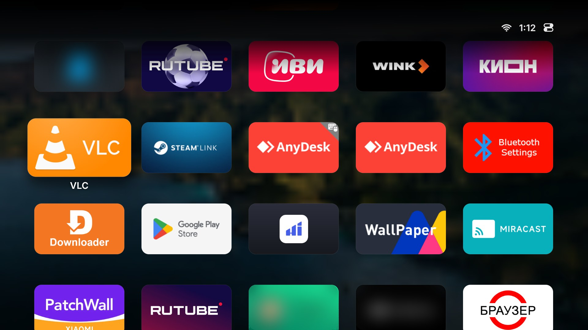
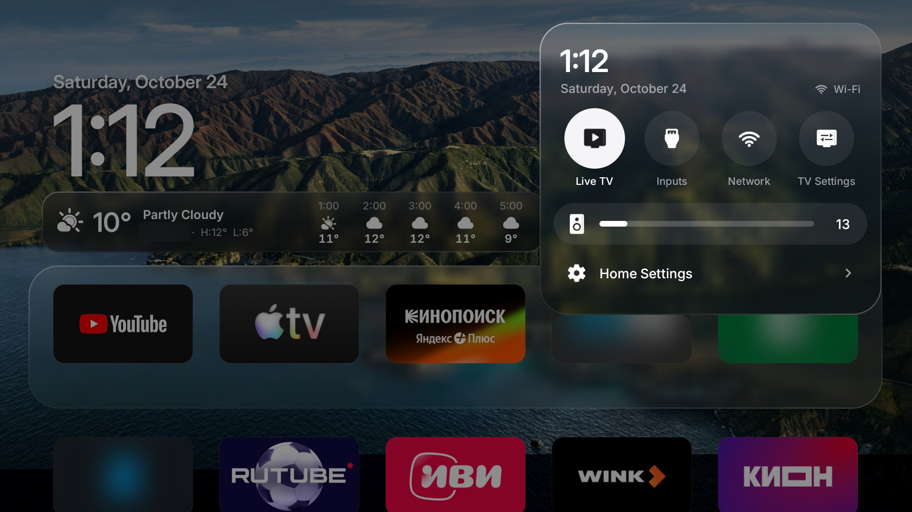
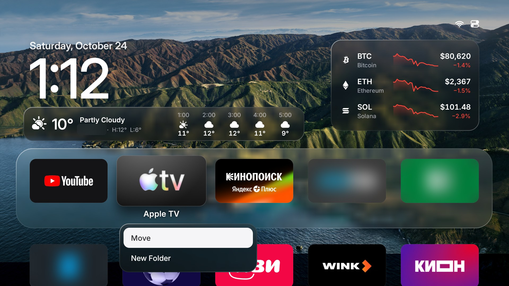

# The Apple TV theme for Free My TV

A tvOS-style home screen for Google TV and Android TV: a large clock with the weather, a Liquid Glass plate under your
favourite apps, folders, a Control Center, a crypto card with charts, and wallpapers in true 4K on 4K TVs.



It is a theme of [Free My TV](README.md): everything Free My TV does (no ads, the switch back to the original home
screen, the watchdog) stays the same. Only the look of the home screen changes.

**Contents:** [What you need](#what-you-need) · [Install](#install) · [Turn on the theme](#turn-on-the-theme) ·
[Using it](#using-it) · [Control Center](#control-center) · [Folders and moving apps](#folders-and-moving-apps) ·
[Weather and crypto](#weather-and-crypto) · [Wallpapers](#wallpapers) · [4K wallpapers](#4k-wallpapers) ·
[Build it with your own settings](#build-it-with-your-own-settings) · [Going back](#going-back) ·
[Troubleshooting](#troubleshooting)

---

## What you need

- A TV or box with **Google TV or Android TV 8 or newer** (Xiaomi, TCL, Sony, Philips, Hisense Android TV, Chromecast
  with Google TV, NVIDIA Shield, onn 4K...). LG (webOS) and Samsung (Tizen) TVs get Free My TV's other look, not this
  theme.
- A computer (macOS, Linux or Windows) on the **same network** as the TV.
- **adb**, Android's debugging tool:
  - macOS: `brew install android-platform-tools`
  - Linux: `sudo apt install adb` (or your distribution's `android-tools`)
  - Windows: [Platform Tools](https://developer.android.com/tools/releases/platform-tools), unzipped, run from its
    folder
- For 4K wallpapers only: **ffmpeg** (`brew install ffmpeg`, `sudo apt install ffmpeg`, or `winget install ffmpeg`)
  and Python 3.

## Install

### 1. Turn on debugging on the TV

- **Google TV / Android TV:** *Settings → System → About* (or *Device Preferences → About*), press OK on *Android TV OS
  build* seven times until it says you are a developer. Then *Settings → System → Developer options*: turn on **USB
  debugging** (some TVs call it *Network debugging* or *ADB debugging*).
- **Xiaomi TVs (PatchWall):** *Settings → About → Product model*, press OK until developer mode turns on; then
  *Settings → Account & Security*: turn on **ADB debugging** and **Install unknown apps**.
- **Chromecast with Google TV (Android 14):** turn on *Wireless debugging* in Developer options, then on the computer
  `adb pair <address:port> <code>` (both shown on the TV) and `adb tcpip 5555`.

Find the TV's IP address in *Settings → Network & Internet → (your network)*.

### 2. Install the app

Download **FreeMyTV-appletv.apk** from the [latest release](https://github.com/TideJr/free-my-tv/releases/latest), then on the computer:

```bash
adb connect 192.168.1.50:5555
adb install -r FreeMyTV-appletv.apk
```

(Use your TV's address.) The first time, the TV asks **Allow USB debugging?**: tick *Always allow from this computer*
and choose *OK*. If `adb install` seems stuck, look at the TV: Google Play Protect may be asking. Choose *More details
→ Install anyway* (it asks only once).

On **TCL** TVs, also allow it to run in the background:

```bash
adb shell "appops set io.freemytv AUTO_START allow || appops set io.freemytv APP_AUTO_START allow"
```

### 3. Switch the home screen on the TV

Before switching, disconnect the computer: `adb disconnect`. Then, with the remote:

1. Open **Free My TV** from the TV's apps.
2. Choose **Home Screen → Free My TV**.
3. The TV asks once more to allow debugging (this time for the app itself): allow it.

Free My TV makes itself the home screen, sets its screensaver and turns off a short list of promotional apps (never
uninstalled). **Home Screen → Original** brings everything back. See [What it changes](README.md#what-it-changes).

## Turn on the theme

On the TV: **Free My TV → Home Settings → Theme**, then press → until it says **Apple TV**. Press Back: the home screen
opens in the new look. The release APK starts with the Apple TV theme already chosen.



In **Home Settings** you also set:

| Setting | What it does |
|---|---|
| **Language** | The app's language (25 languages), or *Automatic* to follow the TV. |
| **Temperature** | °C, °F, or automatic. |
| **Theme** | Automatic / Light / Dark (the classic Free My TV look) or **Apple TV**. |
| **My Photos** | Your own photos as wallpapers (see [Wallpapers](#wallpapers)); OK removes them. |
| **Navigation sounds** | The soft click when you move. |
| **Weather widget** | Shows or hides the weather card. |
| **City** | Where the weather and the sunrise and sunset are for. Press OK and type the city's name. |
| **Quotes widget** | Shows or hides the crypto card. |
| **Chart** | The crypto charts' range: **24 hours**, **7 days** or **30 days**. |
| **Bitcoin / Ethereum / Solana** | Which coins the card shows. |

## Using it

The top row of apps sits on a pane of glass, like on tvOS. The app in focus lifts toward you, with its name under it.
Go down, and the clock and the glass make way for the grid of all your apps on a frosted background.



| On the remote | What happens |
|---|---|
| **Arrows** | Move between apps. At the edge of the grid the tile bounces. |
| **OK** | Opens the app, or opens a folder. |
| **Hold OK** (or **Menu ☰**) | Opens the app's menu: *Move*, *New Folder*, *Add to …* |
| **Up** from the top row | Goes to the pill at the top right; **OK** there opens Control Center. |
| **Back** | Inside the grid: back to the top row. In a folder or a menu: closes it. |
| **Home** | Everything closes and the first app takes the focus. |

The order of your apps starts with the shelf you chose in *Free My TV → Shelf*, then video apps, then everything else
by name. Once you move an app or make a folder, your order is kept, and apps you install later go at the end.

## Control Center

Press **Up** from the top row, then **OK** on the pill at the top right.



- **Live TV**: the TV's tuner (only on TVs that have one).
- **Inputs**: the HDMI inputs. Choose one to switch to it; the first row goes back.
- **Network**: the TV's Wi-Fi or Ethernet settings.
- **TV Settings**: the TV's own settings.
- **Volume**: ← and → change it, **OK** mutes and unmutes.
- **Home Settings**: Free My TV's settings.

**Back** closes it.

## Folders and moving apps

Hold **OK** on an app (or press **Menu**):



- **Move**: the app wiggles. Move it with the arrows, **OK** puts it down, **Back** cancels.
- **New Folder**: puts the app in a new folder (named *Folder*, *Folder 2*...).
- **Add to "Folder"**: puts the app in a folder you already have.
- Inside a folder, hold **OK** on an app → **Remove from Folder**. A folder that empties goes away.

Your order and folders are kept on the TV, through restarts and updates.

## Weather and crypto

**Weather.** The card under the clock shows the weather now and for the next five hours, with today's high and low.
Set your city in *Home Settings → City*. The data comes from:

1. [Yandex Weather](https://yandex.ru/pogoda/b2b/console), if you build the app with your own key
   (`yandex_weather_key`, see [below](#build-it-with-your-own-settings)). Yandex's free plan lasts only 7 days, then it
   is paid.
2. Otherwise [MET Norway](https://api.met.no/): free, no key, worldwide.
3. If MET Norway can't be reached, [Open-Meteo](https://open-meteo.com/).

**Crypto.** The card at the top right shows Bitcoin, Ethereum and Solana with a chart of the range you chose
(*Home Settings → Chart*). The chart and the change are green when the price went up over that range, red when it
went down. Prices come from Binance's public API every 5 minutes, in the currency you build the app with (`currency`:
USD in the release). Turn coins on or off in *Home Settings*, or the whole card with *Quotes widget*.

## Wallpapers

Without any wallpapers of your own, the theme draws a dusk sky. To use your photos, send them from the computer (the TV
connected over adb, see [Install](#install)):

```bash
python3 tools/photos.py 192.168.1.50 beach.jpg mountains/ Holidays/
```

(These scripts are in this repository: download it with *Code → Download ZIP* and run them from its folder.)

- Up to 100 photos. JPEG, PNG, WebP, and HEIC on Android 9 and newer. They are cropped to 16:9 and stripped of GPS and
  other tags.
- One photo per hour is the home screen's wallpaper; the screensaver shows them all.
- **Time of day:** put `dawn`, `day`, `dusk` or `night` in a file's name (for example `night-city.jpg`,
  `Mojave-Day.jpg`). That photo then shows only at that time, worked out from your city's sunrise and sunset. Photos
  without one show at any time.
- *Home Settings → My Photos*: the arrows turn them on or off, **OK** removes them all.

Good sources: [512pixels.net](https://512pixels.net/projects/default-mac-wallpapers-in-5k/) (every macOS wallpaper in
5K and 6K), [Basic Apple Guy](https://basicappleguy.com/), [Unsplash](https://unsplash.com/) (free photos). Apple's
wallpapers belong to Apple: use them on your own TV, don't redistribute them.

## 4K wallpapers

On most 4K TVs, Android draws its whole interface at **1920×1080** and stretches it to the panel. A wallpaper drawn
there can never be sharper than 1080p, whatever its size.

Video takes another way to the panel, at the panel's own resolution. So `tools/walls4k.py` turns each picture into a
still **4K HEVC video** (3840×2160, 10-bit, BT.709), and the home screen shows it on the TV's **video layer**, behind
the clock and the tiles. The result is a wallpaper in true 4K, with the interface on top.

```bash
python3 tools/walls4k.py 192.168.1.50 Wallpapers/       # convert and send
python3 tools/walls4k.py 192.168.1.50 --list            # what is on the TV
python3 tools/walls4k.py 192.168.1.50 --clear           # remove them all
```

- Start from pictures of **3840×2160 or larger** (the macOS wallpapers above come at 5K and 6K). A smaller one is
  scaled up, and the script says so.
- Times of day in the names work as for your photos (`dawn`, `day`, `dusk`, `night`). One wallpaper per hour.
- Each one takes 3 to 4 MB on the TV, in the app's own folder.
- 4K wallpapers take priority over *My Photos*. Remove them with `--clear` to go back to your photos.
- The home screen gives the video decoder back to the TV as soon as you open an app, so YouTube and other players have
  it.
- Your TV needs an HEVC decoder for 3840×2160 (almost every 4K TV has one). The screensaver still shows the wallpapers at
  1080p.

## Build it with your own settings

The release APK has no city, no keys and the dollar as currency. To build one with your city, currency or keys:

```bash
git clone -b apple-tv-theme https://github.com/TideJr/free-my-tv.git
cd free-my-tv
./build.sh            # the first run creates config.properties
```

You need a JDK 17 and the Android SDK command-line tools (build-tools 34 and platform android-34); see
[Install](README.md#install). Then edit `config.properties`:

```properties
theme=appletv
language=en                # or auto, ru, de, pt...
currency=USD               # EUR, RUB, BRL...: the crypto prices
city=Lisbon
latitude=38.7223
longitude=-9.1393
temperature=C
show_crypto=true
tmdb_key=                  # optional: TMDB picks for the classic look and the screensaver
yandex_weather_key=        # optional: Yandex Weather instead of MET Norway
```

Run `./build.sh` again: it ends with `Built FreeMyTV.apk`. Install it as above. Keys are yours and secret: they stay in
`config.properties`, which is never committed.

Keep `freemytv.keystore`, which the first build creates: updates must be signed with the same key. An APK signed with
another key (like the release one) installs only after uninstalling the previous one.

What you change on the TV in *Home Settings* always wins over `config.properties`.

## Going back

- **Another look:** *Home Settings → Theme → Automatic / Light / Dark*.
- **The TV's original home screen:** *Free My TV → Home Screen → Original*. The original home screen, screensaver and
  apps come back.
- **Remove 4K wallpapers:** `python3 tools/walls4k.py <TV IP> --clear`.
- **Uninstall:** switch to *Original* first, then `adb uninstall io.freemytv` (or uninstall it from the TV's apps).

If you uninstalled it while still in Free My TV mode, see
[Uninstalled while in Free My TV mode?](CLAUDE.md#adapting-it-to-another-tv).

## Troubleshooting

| Problem | What to do |
|---|---|
| The theme doesn't change | *Home Settings* on the TV wins over `config.properties`: set *Theme → Apple TV* there. |
| The language doesn't change | Same: *Home Settings → Language*. |
| No weather card | Set your city in *Home Settings → City*, and check *Weather widget* is on. Your network must reach `api.met.no`. |
| Crypto prices show "—" | Binance couldn't be reached. They come back within 5 minutes when the network does. |
| 4K wallpapers don't show | Check they arrived: `python3 tools/walls4k.py <TV IP> --list`. Each needs its `.mp4` and its `.jpg`. Read `adb logcat -s FreeMyTV` for "4K wallpaper" lines. |
| Back closes nothing on the top row | That's on purpose: on the top row, Back stays on the home screen. |
| No Menu button on the remote | Hold OK instead. |
| `adb install` hangs | Google Play Protect is asking on the TV: *More details → Install anyway*. |
| `adb connect` fails on a Mac with *No route to host* | Allow your terminal app in *System Settings → Privacy & Security → Local Network*. |

More in the main [README](README.md) and in [CLAUDE.md](CLAUDE.md), the full guide for AI assistants (it also walks
an assistant like Claude Code through the whole install for you).

## Credits

The layout follows [Aerial](https://github.com/pengchujin/aerial-tv) by [@pengchujin](https://github.com/pengchujin)
(MIT). Weather by [MET Norway](https://api.met.no/) (CC BY 4.0), [Open-Meteo](https://open-meteo.com/) (CC BY 4.0) or
[Yandex Weather](https://yandex.ru/pogoda/b2b). Prices from the [Binance](https://www.binance.com/) public API. Not
affiliated with Apple, Google or any TV maker; app names and logos belong to their owners.
