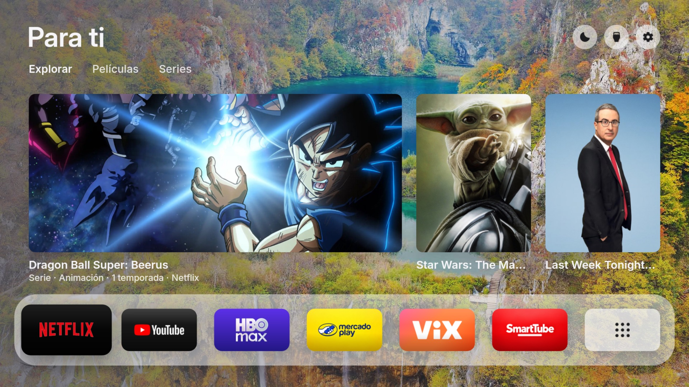

# Free My TV for Fire TV Stick 4K (Fire OS 6 / Android 7.1, API 25) · Free My TV para Fire TV Stick 4K

A fork/adaptation of [simbasjungles/free-my-tv](https://github.com/simbasjungles/free-my-tv) (MIT). All credit for the
launcher's design and code goes to its original authors; this branch ports it to Android 7.1 and adds Fire TV features.
Una adaptación de [simbasjungles/free-my-tv](https://github.com/simbasjungles/free-my-tv) (MIT). El diseño y el código
del launcher son de sus autores originales; esta rama lo porta a Android 7.1 y añade funciones para Fire TV.

[English](#english) · [Español](#español)

---

## English

### Compatibility
- Tested on: **Fire TV Stick 4K, 1st generation** ("mantis", AFTMM), **Fire OS 6.7.1.1 = Android 7.1 / API 25**, 1.3 GB RAM.
- `minSdk` is now **25** (the original needed 26). Newer Androids (8+) run the same APK; nothing was removed for them.
- On Fire OS the app **never runs system-changing ADB routines** (`Adb.connect` is disabled): the *Free My TV / Original*
  switch of the Google TV version is not available. You set Free My TV as the home app yourself (for example with a
  home-selector app such as Wolf Launcher) and keep a way back; nothing is uninstalled or disabled by the app.

### What was added
- **Android 7.1 compatibility**: no `String.join`, no `AdaptiveIconDrawable` on API 25, no hardware bitmaps before 26,
  static Inter instances instead of variable-font weights, no `JobScheduler` from the app on API 25.
- **Scrollable smart dock**: six apps show in a clipped, smoothly scrolling window; **More apps** is fixed on the right
  (outside the scroll area) and only gets focus after the last app. **Pac-Man (or any pinned app) is always last.**
  Every streaming app on the TV is on the dock; the daily order follows use (Android usage stats when the permission
  is granted, plus opens from the launcher; 14-day half-life; at most one swap per day, and only when clearly ahead).
  Nothing moves while you navigate. Manual mode: *Home Settings → Dock order*.
  Streaming apps that are installed later are **detected automatically** (user apps that publish to the TV home with
  `WRITE_EPG_DATA`, minus audio-only apps). Hold OK on an app in *More apps* to put it on the dock; on the dock hold OK,
  then ↓, to send it back.
- **More apps** (no duplicates of the dock): streaming first, then other entertainment, games, the rest; *Tools* keeps
  ADB tools, launchers and utilities. Aerial Views and Amazon's own Prime Video are hidden from the list.
- **Corner button for Aerial Views** (`com.neilturner.aerialviews`, `TestActivity`) and the gear opens Fire OS's real
  Settings (`MainSettingsActivity`; `ACTION_SETTINGS` lands on a dummy handler on Fire OS).
- **Bottom drawer redesign**: one compact glass card with weather (°C), clock/date and sunrise/sunset, plus a row of
  **YouTube** 16:9 thumbnails (public RSS feeds, no key; they open in SmartTube when installed). Titles only.
- **Themes and backgrounds**: *Original / Landscapes / Mixed* (Bing photos, rotating every 30 min; *Mixed* returns to the
  plain background 1 of 3 intervals). Day/night follows the real sunset. Photo backgrounds keep the dark scrims by day
  (slightly lighter, gray) with the light-theme interface on top.
- **Picks**: TMDB flatrate providers for your region; Netflix/HBO Max/Disney+/ViX weigh more, Apple TV (provider 350
  only, never the Apple TV Store) and Prime Video less; *"… Amazon Channel"* entries are ignored.
- **Icons**: per-app replacement cards (`/sdcard/Android/data/io.freemytv/files/logos/tiles/<package>.png`, 16:9, e.g.
  768×432, full-bleed, square corners and no transparency: the launcher rounds them) or logos (`logos/<key>.png`).
  The cards in *More apps* look the same as on the dock, and every card that the launcher doesn't draw itself gets the same
  soft depth gradient (light at the top, darker foot) as the Netflix/YouTube cards.
- **Wallpapers** adapted without `java.nio.file`; **Aerial Views** works as the system screensaver (configure it in its own app).

### Install
1. `cp config.example.properties config.properties` and edit: your city's `latitude`/`longitude`, `tmdb_region`, and your own
   free TMDB key in `tmdb_key` (optional; without it you get no picks). Never commit that file.
2. Build (JDK 17, Android SDK build-tools 34, platform android-34): `./build.sh` → `FreeMyTV.apk`
   (details in the original README). The first build creates a signing key
   (`freemytv.keystore`): keep it private and reuse it for updates.
   **Or** download the ready APK from the **Releases** page (built without a TMDB key).
3. `adb connect <TV-IP>:5555` then `adb install -r FreeMyTV.apk`.
4. Optional, for dock ordering by real use: `adb shell appops set io.freemytv GET_USAGE_STATS allow`.
5. Make it your home app with your preferred method. **Keep a way back** (another launcher or `adb shell cmd package set-home-activity`).

### Limitations
- Only verified on the Fire TV Stick 4K gen 1. Other Fire OS 6 devices should work but are untested.
- No in-app Free My TV ⇄ Original switch on Fire OS (by design, see above). Alexa and the Amazon Appstore keep working.
- Screenshots of DRM video are black (Android protection); playback itself was checked.
- The Mercado Play adaptation used in testing is **not included** (and no third-party APKs are distributed).
- Some new labels ("Fondos", "Orden del dock") are Spanish-only for now.
- The version you build has your own TMDB key inside: do not share that APK.

---

## Español

### Compatibilidad
- Probado en: **Fire TV Stick 4K de 1.ª generación** («mantis», AFTMM), **Fire OS 6.7.1.1 = Android 7.1 / API 25**, 1.3 GB de RAM.
- `minSdk` ahora es **25** (el original pedía 26). Los Android 8 o superiores usan la misma APK.
- En Fire OS la app **no ejecuta rutinas ADB que cambien el sistema** (`Adb.connect` está desactivado): no existe el
  interruptor *Free My TV / Original* de la versión para Google TV. Tú pones Free My TV como app de inicio (por ejemplo
  con Wolf Launcher) y conservas una vía de regreso; la app no desinstala ni deshabilita nada.

### Novedades
- **Compatibilidad con Android 7.1** (sin `String.join`, sin `AdaptiveIconDrawable`, sin bitmaps de hardware antes de la 26, tipografía Inter estática, etc.).
- **Dock inteligente y desplazable**: seis apps visibles en una ventana con recorte; **«Más aplicaciones» fijo** a la
  derecha, fuera del desplazamiento, con foco solo tras la última app. **Pac-Man (o la app fijada) siempre va al final.**
  Todas las apps de streaming están en el dock; el orden diario sigue el uso real (estadísticas de Android si das el
  permiso, más las aperturas desde el launcher; vida media de 14 días; un solo cambio por día y solo si la ventaja es clara).
  Nada se mueve mientras navegas. Modo manual en *Ajustes de inicio → Orden del dock*.
  Las apps de streaming que instales después se **detectan solas** (apps de usuario que publican en el inicio de la TV
  con `WRITE_EPG_DATA`, salvo las de solo audio). Mantén OK sobre una app de *Más aplicaciones* para pasarla al dock; en el
  dock, mantén OK y pulsa ↓ para devolverla.
- **Más aplicaciones** sin repetir las del dock: streaming primero, luego entretenimiento, juegos y el resto; *Herramientas*
  guarda ADB, launchers y utilidades. Aerial Views y el Prime Video nativo de Amazon no aparecen.
- **Botón de esquina para Aerial Views** y engrane que abre los **ajustes reales de Fire OS**.
- **Panel inferior rediseñado**: una tarjeta compacta de cristal con clima (°C), hora/fecha y amanecer/atardecer, más
  una fila de miniaturas **YouTube** 16:9 (RSS públicos, sin clave; se abren en SmartTube si está instalado).
- **Temas y fondos**: *Original / Paisajes / Mixto* (fotos de Bing que rotan cada 30 min; en *Mixto* 1 de cada 3 intervalos
  vuelve al fondo base). Día/noche según el atardecer real. Con fotos de día se mantienen los velos oscuros (algo más
  claros y grises) con la interfaz del tema claro encima.
- **Recomendaciones**: proveedores *flatrate* de TMDB para tu región; Netflix, HBO Max, Disney+ y ViX pesan más; Apple TV
  (solo proveedor 350, nunca la tienda) y Prime Video menos; se ignoran los «… Amazon Channel».
- **Iconos**: tarjetas propias por app (`logos/tiles/<paquete>.png`, 16:9 a sangre, esquinas cuadradas y sin transparencia)
  o logos sueltos; las tarjetas de «Más aplicaciones» se ven igual que en el dock, y todas las tarjetas que el launcher no dibuja por sí mismo reciben el mismo degradado suave (claro arriba, pie más oscuro) que Netflix y YouTube.

### Instalación
1. `cp config.example.properties config.properties` y edita latitud/longitud, `tmdb_region` y tu propia clave gratuita de
   TMDB (`tmdb_key`, opcional). **Nunca subas ese archivo.**
2. Compila (JDK 17, build-tools 34, android-34): `./build.sh` → `FreeMyTV.apk`; la primera vez crea tu llave de firma
   (`freemytv.keystore`): guárdala en privado y reutilízala en las actualizaciones. **O** descarga la APK de **Releases**
   (compilada sin clave de TMDB).
3. `adb connect <IP-de-la-TV>:5555` y `adb install -r FreeMyTV.apk`.
4. Opcional, para ordenar el dock por uso real: `adb shell appops set io.freemytv GET_USAGE_STATS allow`.
5. Ponla como app de inicio con tu método preferido y **conserva una vía de regreso**.

### Limitaciones
- Solo verificado en el Fire TV Stick 4K gen. 1; otros Fire OS 6 deberían funcionar, sin probar.
- Sin interruptor Free My TV ⇄ Original dentro de la app en Fire OS (por diseño). Alexa y la tienda de Amazon siguen funcionando.
- Las capturas de vídeo con DRM salen negras; la reproducción sí se comprobó.
- La adaptación de Mercado Play usada en las pruebas **no se incluye** (no se distribuyen APK de terceros).
- Algunas etiquetas nuevas («Fondos», «Orden del dock») están solo en español por ahora.
- La APK que compiles lleva tu clave de TMDB dentro: no la compartas.

## Screenshots · Capturas
| | |
|---|---|
|  |  |
|  |  |
|  |  |
|  |  |
|  | |

Real captures from the Fire TV Stick 4K (1st gen) · Capturas reales del Fire TV Stick 4K (1.ª gen.).

## Credits · Créditos
Original project: simbasjungles/free-my-tv and contributors (MIT, see [LICENSE](LICENSE)). Inter font: SIL OFL 1.1
(`app/assets/fonts/OFL.txt`). Weather: Open-Meteo; picks: TMDB (this product uses the TMDB API but is not endorsed or
certified by TMDB); photos: Bing's daily images; video thumbnails: YouTube. App logos are trademarks of their owners
and are shown only to identify the installed apps.

## Later changes
- Top button renamed **Modo ambiente** (same function). Fire OS power: `screen_off_timeout` starts the screensaver, `sleep_timeout` (95 min) sleeps the device and Fire OS sends HDMI-CEC standby; `RESTORE_POWER.sh` restores the originals.
- Wallpapers: Bing pool from 12 markets (idx 0 and 8), refreshed every 24 h, persistent history of 400 seen images, no repeats until the pool is used up.
- Recommendations: 2 trending pages + 3 discover pages per kind (~200 titles), 3 picks per hour chosen at random (Netflix/HBO Max/Disney+/ViX 3x, Prime one hour in four), kept across restarts, never repeated until the list is exhausted.
- `Adb.connect()` throws a clear `IOException` on Fire OS instead of touching Amazon components.
- Screensaver alternative (separate GPLv3 project): https://github.com/hectorx24/aerialviews-plus-fireos6
